# Práctica 3: Viajando en el Tiempo y Corrigiendo el Historial

**Hugo Martín Toledano - 2º DAW**

---

# Fase 1: Inicialización y primeros commits

## Paso 1: Creación del proyecto

He configurado la rama `main`, creado la carpeta de la práctica e inicializado el repositorio.

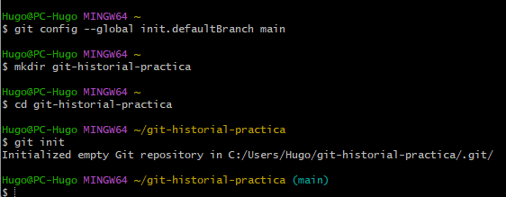

---

## Paso 2: Commit C1

He creado `calculadora.py` con la función `sumar` y he realizado el primer commit.

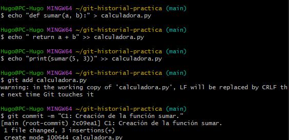

Así quedó el archivo después de crear la función:

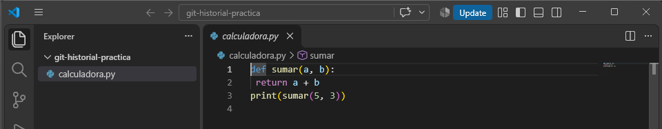

---

## Paso 3: Commit C2

He añadido la función `restar` y después he guardado el cambio en un nuevo commit.

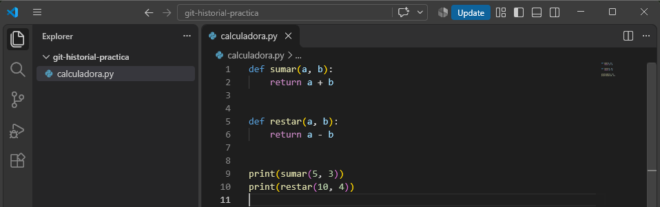

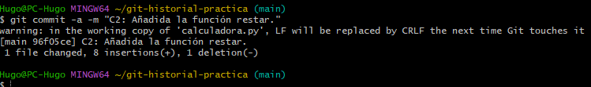

---

# Fase 2: Inspección y etiquetado del historial

## Tarea 2.1

He revisado el historial completo y en C2 aparecen **8 inserciones y 1 eliminación**.

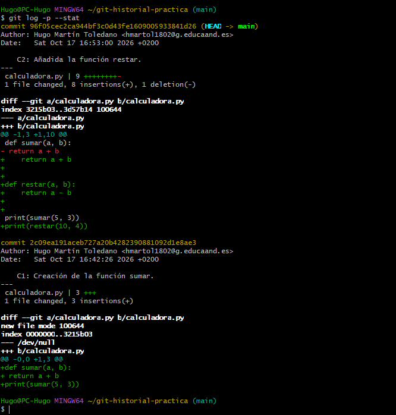

---

## Paso 2: Historial resumido

He mostrado los commits en una sola línea para ver mejor sus hashes.

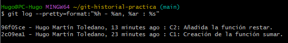

---

## Tarea 2.2

He creado la etiqueta `v1.0-estable` y he comprobado que aparece correctamente.

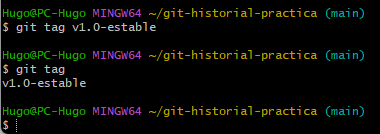

---

## Tarea 2.3

He comparado C1 con `v1.0-estable` y aparece la función `restar` como cambio añadido.

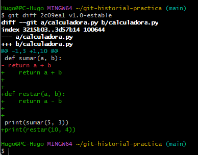

---

# Fase 3: Deshaciendo y corrigiendo cambios

## Tarea 3.1

He añadido el comentario erróneo y después lo he eliminado con `git restore`. Al final el repositorio vuelve a estar limpio.

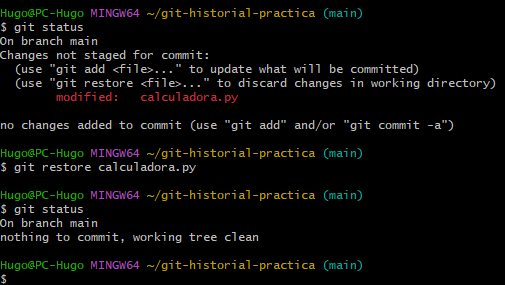

---

## Paso 2: Cambio en staging

He añadido el cambio al staging, lo he sacado de nuevo y finalmente he descartado el cambio.

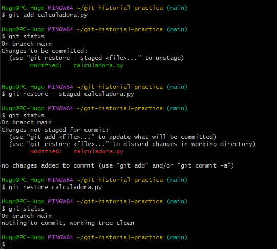

---

## Paso 3: Commit C3

He creado C3 con la función `multiplicar` mal hecha de forma intencionada.

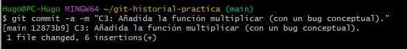

Este era el código con el error:

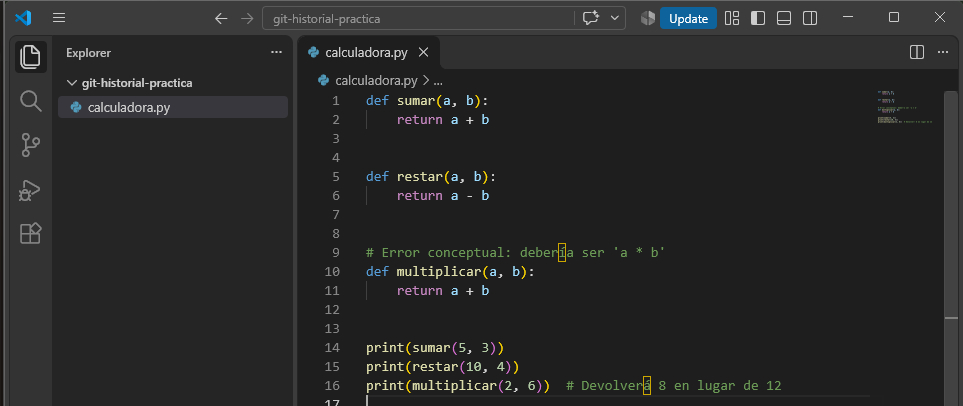

---

## Tarea 3.2

He usado `git revert` para deshacer C3 sin borrarlo del historial.

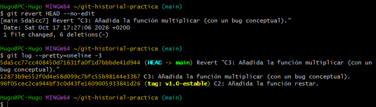

---

## Paso 5: Corrección de multiplicar

He corregido la función para que haga la multiplicación correctamente.

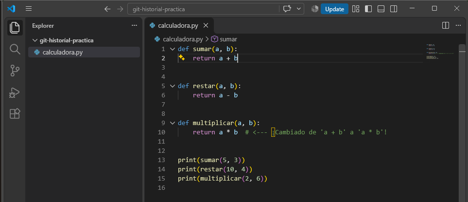

---

## Tarea 3.3

He usado `amend` para modificar el último commit. El nuevo C4 tiene el mensaje corregido y un hash diferente.

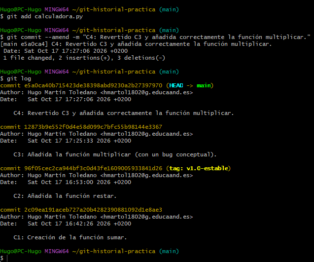

---

# Autoevaluación

## 1. ¿Cuál es el hash abreviado del commit C1?

 El hash abreviado del commit es `2c09ea1`

---

## 2. Comando para ir al commit anterior a `v1.0-estable`

```bash
git switch --detach v1.0-estable^
```

---

## 3. ¿Qué habría pasado usando `git reset --hard` en vez de `git revert`?

Habría borrado commits de mi historial y podría dar problemas si otras personas ya tenían esos commits en su repositorio.

Con `git revert` no se borra el historial, simplemente se añade otro commit que deshace el cambio.

---

## 4. ¿Dónde apunta HEAD al terminar?

Al final `HEAD` apunta a la rama `main`, por lo que no está en modo `Detached HEAD`.
